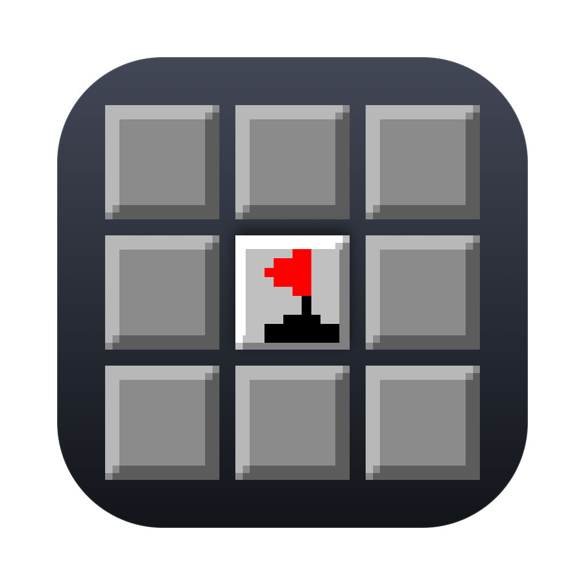
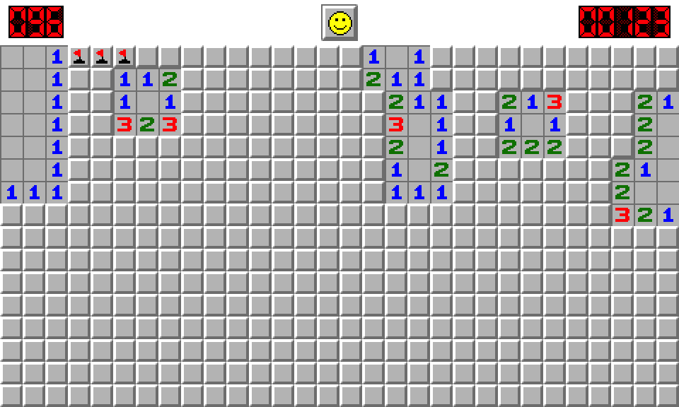
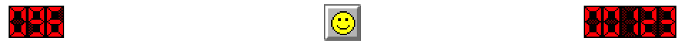
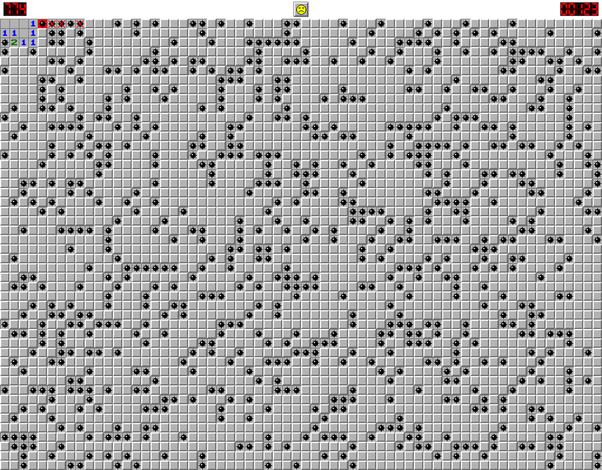

<div align="center">
  
  <h1>扫雷 2000</h1>
  <p><strong>Mine2000</strong> — 用 Swift 6 + AppKit 从零重写的 macOS 原生扫雷</p>

  [](https://github.com/Yiki0613/mine2000-mac/actions/workflows/ci.yml)
  
  
  

  <sub>中文 · <a href="README.en.md">English</a></sub>
</div>



---

## 这是什么

2005 年，AhoSoft 发布过一款日文 Windows 扫雷，叫 **`mine2000`**：五档难度、LED 数码管计时、笑脸按钮、`.m2k` 成绩档。它没有源码，也没出过 Mac 版。

这个项目做了两件事：

1. **把原版的行为规格从二进制里挖出来** —— PE 资源解析拿到图集，反汇编拿到五档难度的雷数、flood fill 的邻域、计时器的时间单位，像素级实测拿到 HUD 每一个元素的坐标；
2. **用 Swift 6 + AppKit 从零写一遍** —— 不跑兼容层、不嵌 Windows 二进制、不依赖任何第三方库。

所以它不是"在 Mac 上能跑的 Windows 程序"，而是一个**长得和原来一模一样、但每一行都是新写的**原生 app。

```bash
git clone https://github.com/Yiki0613/mine2000-mac.git
cd mine2000-mac
bash build.sh app && open .build/Mine2000.app
```

---

## 特性

| | |
|---|---|
| **五档难度** | 初级 8×8 / 10 雷 · 中级 16×16 / 40 · 专家 30×16 / 99 · 大师 48×24 / 256 · 宗师 64×48 / 777 |
| **完整规则** | 首点保护、8 邻域 flood fill、chording（左右键同按）、插旗、计时冻结 |
| **像素级 HUD** | LED 七段数码管、五档表情槽、按压凹陷反馈；计时位数按难度自适应（初级 3 位、其余 5 位） |
| **`.m2k` 成绩档** | 与原版 **字节级互通**，25 条记录可读可写 |
| **高分榜** | 五档成绩查看、录入、清空 |
| **中文界面** | 菜单、难度、弹窗全部中文化，原版日文名保留在代码与文档中可反查 |
| **零依赖** | 不依赖 Xcode 工程、CocoaPods、SPM 包；`swift build` 直接出二进制 |



自上而下：**剩余雷数**（永远 3 位）· **笑脸按钮**（重开 / 按下变凹陷）· **计时器**（0.1 秒单位）。

---

## 三层验证

这个项目用三层测试兜住"看起来对"和"真的对"之间的差距。一条命令跑完：

```bash
bash build.sh verify
```

| 层次 | 项数 | 验证什么 |
|---|---:|---|
| 单元测试 | **129** | 单个函数：棋盘规则、计分、编解码、菜单结构、本地化 |
| 逻辑自检 | **46** | 跨环节衔接：首点布雷 → flood fill → 插旗 → chording → 胜负 → 计时冻结 → 入榜 |
| GUI 自检 | **16** | 画面真的更新了：真实鼠标事件 + 离屏渲染 + **逐像素比对** |

为什么需要第三层？因为这个项目真的踩过这种坑：右键插旗时逻辑层已经正确改状态（`changed=true, flags=1`），但视图漏了 `needsDisplay = true`——**逻辑全对，屏幕毫无反应**。只有把画面渲染出来数像素才发现得了。

> 完整的技术细节（图集结构、反汇编结论、每一处像素坐标的来源）在 [`docs/`](docs/) 里，
> 包括一份 34 KB 的 [行为还原对照表](docs/行为还原对照表.md)，逐条列出原版行为与本项目实现的对应关系。

---

## 还原到什么程度

| 项目 | 原版 `mine2000` v2.21 | 本项目 |
|---|---|---|
| 难度档数与版面 | 5 档，8×8 ~ 64×48 | 一致 |
| 格子尺寸 | 16 px | 一致 |
| 首点保护 | 只保护被点的一格 | 一致 |
| flood fill | 8 邻域（3×3） | 一致 |
| 计时单位 | 0.1 秒 | 一致 |
| 计时器位数 | 初级 3 位，其余 5 位 | 一致（按难度自适应） |
| 雷数显示 | 永远 3 位 | 一致 |
| 表情槽 | 5 种（普通/胜利/失败/惊讶/凹下） | 一致 |
| 成绩档 | `.m2k`，25 条 × 13 字节 | 字节级互通 |
| 界面语言 | 日文 | **中文**（原版日文名保留可反查） |



<sub>宗师：64×48，777 颗雷。</sub>

---

## 它是怎么做出来的

没有源码，只有一份 2005 年的安装包。整个过程大致是：

1. **拆图集** —— 从 PE 的 `.rsrc` 段取出位图。原版图集不是均匀网格，而是 3 段不同规格的子图集纵向拼接（16×16 的格子与数字、13×23 的 LED、26×26 的表情）。
2. **读行为** —— 反汇编五个难度初始化函数，直接拿到 `10 / 40 / 99 / 256 / 777`；再顺着绘制函数找到 HUD 每个元素的整数坐标（比如 LED 目标 y = 4、表情目标 y = 3）。
3. **抠细节** —— 为什么计时器初级只显示 3 位？因为绘制代码里有一句 `cmp 棋盘列数, 8; jle`。为什么会"按下就闪雷"？因为原版按下态画的是凹陷底板，不是雷。
4. **固化成测试** —— 每一条结论都写成一条断言，改坏了立刻红灯。上面那 191 项就是这么攒出来的。

技术文档在 [`docs/`](docs/)：

| 文档 | 内容 |
|---|---|
| [行为还原对照表](docs/行为还原对照表.md) | 逐条对照原版行为与实现，含反汇编地址 |
| [图集规格](docs/图集规格.md) | 45 个图块的精确坐标与像素统计 |
| [中文化改造方案](docs/中文化改造方案.md) | 28 处文案的译名依据 |

---

## 项目结构

```
mine2000-mac/
├── Package.swift              Swift Package 定义
├── build.sh                   build / test / app / icon / verify
├── Sources/Mine2000/
│   ├── App/                   入口、菜单、窗口、自检模式
│   ├── Model/                 棋盘、会话、难度、成绩档编解码
│   ├── View/                  棋盘绘制、HUD、图集切块
│   └── Resources/             图集与图标（原版素材，见 NOTICE）
├── Tests/Mine2000Tests/       129 项单元测试
├── Resources/                 AppIcon.icns（由工具生成）
├── Tools/                     图标生成、图集分析、成绩档检查
└── docs/                      还原对照表、图集规格、截图
```

几个有用的命令：

```bash
bash build.sh build        # 编译
bash build.sh test         # 单元测试
bash build.sh app          # 打包成可双击的 .app
bash build.sh icon         # 从图集像素重新生成应用图标
bash build.sh verify       # 三层验证全跑
```

---

## 已知限制

- **未签名、未公证**。首次打开请右键 →「打开」，或执行
  `xattr -dr com.apple.quarantine "/Applications/扫雷 2000.app"`。
- 高分榜窗口与 `.m2k` 导入导出对话框**没有**端到端自动化测试，只有人工验证。
- 最低支持 macOS 14（单元测试用的 swift-testing 要求）。
- 只支持 Apple Silicon 与 Intel 的 macOS，不考虑 iOS / iPadOS。

---

## 许可

- **代码**：[MIT](LICENSE)，Copyright © 2026 Yiki
- **原版素材**：`tiles_144x81.bmp`、`logo_170x57.bmp`、`mine2000.ico`、`hiscore.dat`
  版权归 Tomohiro Kumagai / Kazuhiro Toyama（AhoSoft）所有，**不在 MIT 覆盖范围内**。
  收录它们仅为还原观感与保证格式兼容，非商业用途。详见 [NOTICE](NOTICE)。

本项目与原版作者无任何隶属关系。若权利人对素材使用有异议，请提 issue，会立即移除。

## 致谢

- **Tomohiro Kumagai、Kazuhiro Toyama（AhoSoft）** —— 原版 `mine2000` 的作者。二十年前那款小游戏，值得被认真对待一次。
- 图标用图集里的真实像素绘制，与游戏内视觉完全一致，不是另画的。
